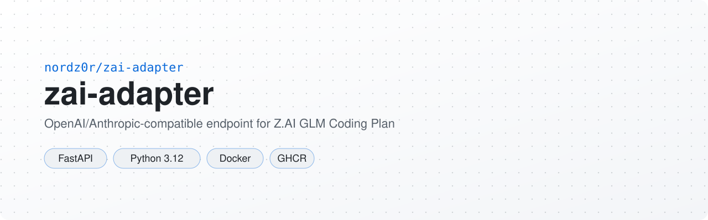

<p align="center">
  <picture>
    <source media="(prefers-color-scheme: dark)" srcset=".github/assets/banner-dark.svg">
    <source media="(prefers-color-scheme: light)" srcset=".github/assets/banner-light.svg">
    
  </picture>
</p>

<p align="center"><a href="README.md">Русский</a> · <b>English</b></p>

<p align="center">
  <a href="https://github.com/nordz0r/zai-adapter/actions/workflows/ci.yml"></a>
  
  
  <a href="https://hub.docker.com/r/nordz0r/zai-adapter"></a>
  <a href="LICENSE"></a>
</p>

An OpenAI-compatible endpoint for the Z.AI GLM Coding Plan with **ZCode client signing**
(the same cryptography as the ZCode desktop client: handshake → Ed25519 → proof-of-work).
Signed requests are billed at the "via ZCode" tier — during the GLM-5.3-Flash promo window
they consume zero plan quota.

## Installation

### Docker

Local run:

```bash
cp .env.example .env      # fill in ZAI_API_KEY (and optionally ADAPTER_API_KEY)
docker compose up --build
# healthz:  curl http://127.0.0.1:8100/healthz
# quota:    curl http://127.0.0.1:8100/quota/text
```

Prebuilt image: `docker.io/nordz0r/zai-adapter:<tag>` / `ghcr.io/nordz0r/zai-adapter:<tag>`
(tags `main`, `sha-<commit>`, `v*` — published by CI).

### From source

```bash
uv sync
uv run uvicorn zai_adapter.app:app --port 8100
```

On Windows `run.bat` does the same (with `--host 0.0.0.0 --reload`).

## Usage

Point an OpenAI client at `http://127.0.0.1:8100/v1`. If `ADAPTER_API_KEY` is set, send it as `Authorization: Bearer …` or `x-api-key`:

```bash
curl http://127.0.0.1:8100/v1/chat/completions \
  -H "Authorization: Bearer $ADAPTER_API_KEY" -H 'Content-Type: application/json' \
  -d '{"model":"glm-5.3-flash","messages":[{"role":"user","content":"ping"}]}'
```

Anthropic-compatible clients use the same origin without `/v1`: requests go to `/v1/messages`.

### Endpoints

| Method | Path | Purpose |
|---|---|---|
| GET | `/healthz` | health probe |
| GET | `/v1/models` | model list (OpenAI format) |
| POST | `/v1/chat/completions` | OpenAI chat → signed Anthropic-wire upstream (`/api/anthropic`); stream requests are returned as a single SSE chunk |
| POST | `/v1/messages` | **Anthropic-compatible 1:1 passthrough**: the body goes to the signed upstream untranslated (tools, thinking, system — lossless); `stream: true` is proxied as native Anthropic SSE |
| POST | `/v1/messages/count_tokens` | Anthropic count_tokens, same 1:1 passthrough |
| GET | `/quota` | plan quota from `api.z.ai/api/monitor/usage/quota/limit` (JSON) |
| GET | `/quota/text` | human-readable line for cron |

### Environment variables

| Variable | Purpose |
|---|---|
| `ZAI_API_KEY` | coding plan key `<id>.<secret>` (required) |
| `ADAPTER_API_KEY` | bearer/x-api-key protecting the adapter itself (empty = no auth) |
| `ZAI_UPSTREAM_URL` | default `https://zcode.z.ai/api/v1/ultra-zai/anthropic` |
| `ZAI_HANDSHAKE_URL` | default `https://api.z.ai/api/paas/c1f3a7e2/v2/client` |
| `ZAI_MONITOR_URL` | default `https://api.z.ai/api/monitor/usage/quota/limit` |
| `ZAI_DEFAULT_MODEL` | default `glm-5.3-flash` |
| `PORT` | default 8100 |

## Development

```bash
uv sync
uv run pytest -q
```

## CI/CD

- `ci.yml` — tests + image build on PRs.
- `dockerhub.yml` — tests + publishes `nordz0r/zai-adapter` (Docker Hub) and
  `ghcr.io/nordz0r/zai-adapter` on push to main and `v*` tags.
  Requires repository secrets: `DOCKERHUB_USERNAME`, `DOCKERHUB_TOKEN`.

## License

MIT, see [LICENSE](LICENSE).
