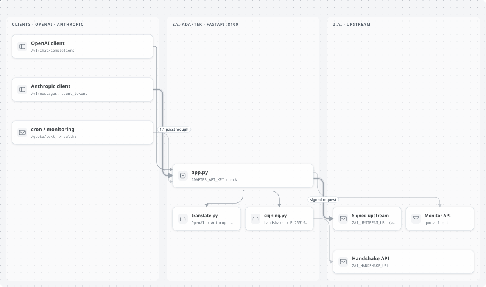

<p align="center">
  <picture>
    <source media="(prefers-color-scheme: dark)" srcset=".github/assets/banner-dark.svg">
    <source media="(prefers-color-scheme: light)" srcset=".github/assets/banner-light.svg">
    
  </picture>
</p>

<p align="center"><b>Русский</b> · <a href="README.en.md">English</a></p>

<p align="center">
  <a href="https://github.com/nordz0r/zai-adapter/actions/workflows/ci.yml"></a>
  
  
  <a href="https://hub.docker.com/r/nordz0r/zai-adapter"></a>
  <a href="LICENSE"></a>
</p>

OpenAI-совместимый endpoint для Z.AI GLM Coding Plan с **подписью клиента ZCode**
(та же криптография, что у десктопного ZCode: handshake → Ed25519 → proof-of-work).
Подписанные запросы проходят по тарифу «via ZCode» — в окне акции GLM-5.3-Flash
расход квоты плана равен нулю.

## Установка

### Docker

Локальный запуск:

```bash
cp .env.example .env      # заполни ZAI_API_KEY (и ADAPTER_API_KEY по желанию)
docker compose up --build
# healthz:  curl http://127.0.0.1:8100/healthz
# квота:    curl http://127.0.0.1:8100/quota/text
```

Готовый образ: `docker.io/nordz0r/zai-adapter:<tag>` / `ghcr.io/nordz0r/zai-adapter:<tag>`
(теги `main`, `sha-<commit>`, `v*` — публикует CI).

### Из исходников

```bash
uv sync
uv run uvicorn zai_adapter.app:app --port 8100
```

На Windows то же делает `run.bat` (с `--host 0.0.0.0 --reload`).

## Использование

Клиенту OpenAI укажите базовый адрес `http://127.0.0.1:8100/v1` и, если задан `ADAPTER_API_KEY`, передайте его как `Authorization: Bearer …` или `x-api-key`:

```bash
curl http://127.0.0.1:8100/v1/chat/completions \
  -H "Authorization: Bearer $ADAPTER_API_KEY" -H 'Content-Type: application/json' \
  -d '{"model":"glm-5.3-flash","messages":[{"role":"user","content":"ping"}]}'
```

Anthropic-совместимым клиентам — тот же адрес без `/v1`: запросы идут в `/v1/messages`.

<p align="center">
  <picture>
    <source media="(prefers-color-scheme: dark)" srcset=".github/assets/architecture-dark.svg">
    <source media="(prefers-color-scheme: light)" srcset=".github/assets/architecture-light.svg">
    
  </picture>
</p>

### Endpoints


| Метод | Путь | Назначение |
|---|---|---|
| GET | `/healthz` | health-проба |
| GET | `/v1/models` | список моделей (OpenAI-формат) |
| POST | `/v1/chat/completions` | OpenAI chat → подписанный Anthropic-wire upstream (`/api/anthropic`); stream-запросы отдаются одним SSE-чанком |
| POST | `/v1/messages` | **Anthropic-совместимый passthrough 1:1**: тело уходит в подписанный upstream без трансляции (tools, thinking, system — без потерь); `stream: true` проксируется как нативный Anthropic SSE |
| POST | `/v1/messages/count_tokens` | Anthropic count_tokens, тот же passthrough 1:1 |
| GET | `/quota` | квота плана из `api.z.ai/api/monitor/usage/quota/limit` (JSON) |
| GET | `/quota/text` | человекочитаемая строка для cron |

### Переменные окружения


| Переменная | Назначение |
|---|---|
| `ZAI_API_KEY` | ключ coding plan `<id>.<secret>` (обязателен) |
| `ADAPTER_API_KEY` | bearer/x-api-key для защиты самого адаптера (пусто = без аутентификации) |
| `ZAI_UPSTREAM_URL` | по умолчанию `https://zcode.z.ai/api/v1/ultra-zai/anthropic` |
| `ZAI_HANDSHAKE_URL` | по умолчанию `https://api.z.ai/api/paas/c1f3a7e2/v2/client` |
| `ZAI_MONITOR_URL` | по умолчанию `https://api.z.ai/api/monitor/usage/quota/limit` |
| `ZAI_DEFAULT_MODEL` | по умолчанию `glm-5.3-flash` |
| `PORT` | по умолчанию 8100 |

## Разработка

```bash
uv sync
uv run pytest -q
```

## CI/CD

- `ci.yml` — тесты + сборка образа на PR.
- `dockerhub.yml` — тесты + публикация `nordz0r/zai-adapter` (Docker Hub) и
  `ghcr.io/nordz0r/zai-adapter` на push в main и теги `v*`.
  Требуются секреты репозитория: `DOCKERHUB_USERNAME`, `DOCKERHUB_TOKEN`.

## Лицензия

MIT, см. [LICENSE](LICENSE).
